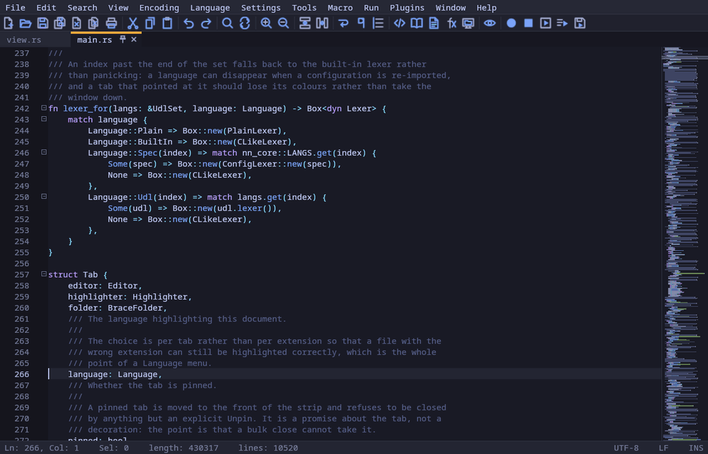
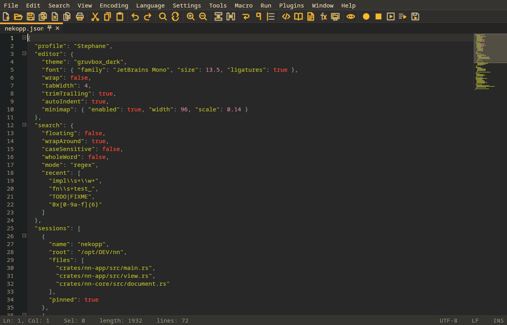
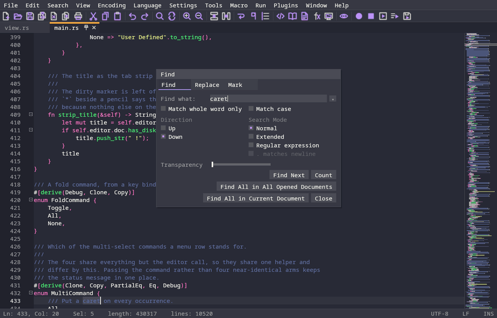
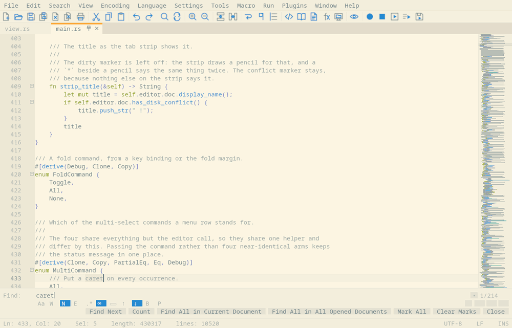
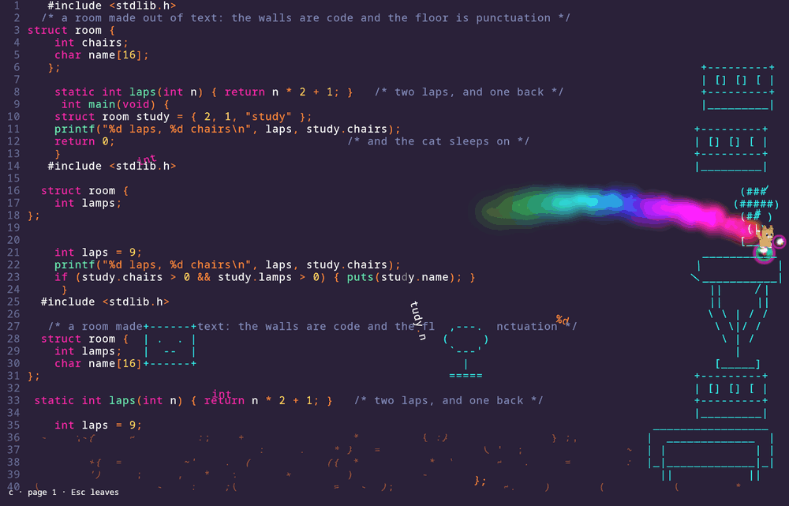

# Neko++

A GPU-rendered text editor in the shape of Notepad++, written in Rust. The
binary is `npp`.

It opens text files, edits them and puts them back on disk, with Notepad++'s
menus, shortcuts and file formats, because those are what a person switching
editors has to relearn. The engine underneath is new: a rope document, an
incremental lexer, a WebAssembly plugin interpreter, and a renderer that draws
the page with `wgpu`. It shares no code with Notepad++ or Scintilla.

Version 0.3.0. Linux today; Windows and macOS are not ported yet.

## Screenshots



`crates/nn-app/src/main.rs` in Tokyo Night: the tab strip, the fold markers in
the gutter, doc comments in grey, the minimap down the right.



A settings file of the shape the app writes, in Gruvbox Dark. The JSON lexer
tells keys, strings and numbers apart.



`Ctrl+F` with Floating Search on: Notepad++'s panel, its buttons and its
transparency slider, floating over the text. Dracula.



The same search with Floating Search off: the bar docks at the bottom, option
row and count of matches -- 1 of 214 -- in view. Solarized Light.



`Ctrl+Alt+K`: a kitten loose in a room built out of code, and the rainbow trail
a dash leaves behind it. Synthwave '84. `Esc` goes back to the document.

## What it does

- **The document**: a rope, so an insert in the middle of a 200 MB file does not
  copy it; undo, column mode, bookmarks, folding, incremental highlighting that
  stops as soon as it agrees with what it stored.
- **The window**: tabs, split view, a minimap, a function list, a folder panel, a
  results panel, sessions, autosaved snapshots and crash recovery.
- **The menus**: Notepad++'s tree, one row per command, same wording, same
  default keys. A row that does nothing is not in the menu, and
  `docs/nekopp-features.md` ends with the list of features that are missing and
  the reason for each.
- **Find and replace**: the dialog's options on the docked bar, with Enter acting
  the replacement; Notepad++'s floating Search window is a preference away.
- **Notepad++'s files**: reads `config.xml`, `shortcuts.xml`, `stylers.xml` and
  `userDefineLang.xml`, and writes `shortcuts.xml` back. Localisation files load
  as they are.
- **Encodings**: UTF-8 and UTF-16 with and without a mark, the code pages
  Notepad++ offers, and the three line endings.
- **Plugins**: WebAssembly, one `.wasm` file per plugin, run in an interpreter
  with its own limits rather than in the editor's address space.
- **Automation**: `npp --call` takes a JSON request against the running window,
  `npp-mcp` serves the same commands over MCP on standard input with no window
  and no display, and `npp --rest` serves them as REST on `127.0.0.1`.
- **Playground**: `Ctrl+Alt+K` hands the window to a page of code with a kitten
  on it, which walks the page, climbs the furniture, takes the text apart and
  falls asleep. It is not in Notepad++.

## Building

Rust 1.85 or newer, and on Debian or Ubuntu:

```sh
sudo apt install build-essential pkg-config libxkbcommon-dev libwayland-dev \
    libx11-dev libxcb1-dev libvulkan-dev
cargo build --release
./target/release/npp some/file.txt
```

The GPU path wants a working Vulkan driver: Mesa's `mesa-vulkan-drivers`, or the
vendor's own. Where there is none -- a container, a remote session, a machine
with no adapter -- `npp --software` draws the same scene with the software
rasteriser.

```sh
cargo test
```

## Packaging

```sh
packaging/build-deb.sh        # dist/npp_0.3.0_amd64.deb
packaging/build-appimage.sh   # needs appimagetool on PATH
```

## Documentation

| File | What it is |
|---|---|
| `docs/nekopp-features.md` | the reference: every menu row, option, key and file the editor reads |
| `docs/nekopp-features.pdf` | the same document, typeset |
| `ENGINEERING.md` | why each piece is built the way it is, pass by pass |
| `NL-COMMAND.md` | the command line, at length |
| `crates/nn-mcp/README.md` | the MCP server and how to register it with a client |

## The MCP server

`npp-mcp` speaks JSON-RPC on standard input, one object per line, and serves the
feature reference as searchable sections and as resources, the default keymap,
and the editor's own commands:

```sh
hello='{"jsonrpc":"2.0","id":1,"method":"initialize","params":{"protocolVersion":"2024-11-05","capabilities":{},"clientInfo":{"name":"shell","version":"1"}}}'
printf '%s\n' "$hello" '{"jsonrpc":"2.0","method":"notifications/initialized"}' \
  | target/release/npp-mcp
```

`run_command` takes a command and a string or a path and answers with the text,
so a harness can sort, dedupe, re-indent or convert a file without a display.

## The tree

| Path | What is in it |
|---|---|
| `crates/nn-core` | the editor without a window: document, caret, undo, search, folding, lexers, code pages, printing layout, the WebAssembly interpreter |
| `crates/nn-app` | everything that needs a screen: the renderer, the widgets, the menus, the dialogs, the session, the settings, the dispatcher |
| `crates/nn-mcp` | the documentation-and-commands server |
| `plugins/` | the example plugins and their own workspace |
| `packaging/`, `debian/` | the desktop entry, the icons, the package build |

## Licence

GNU General Public License, version 3, and not "or later": the whole text is
`LICENSE` at the top of the tree, `Cargo.toml` says `GPL-3.0-only`, and every
source file opens with the copyright line and the permission notice. The editor
shows the same notice in Help > About, and Help > Neko++ License opens the terms.

No code from Notepad++ or Scintilla is included; the file formats are read and
written from their descriptions, and the plugins are WebAssembly modules rather
than DLLs. The Korean font is the one exception to the licence above, and it is
under the SIL Open Font License, kept in `crates/nn-app/assets/OFL.txt`.
